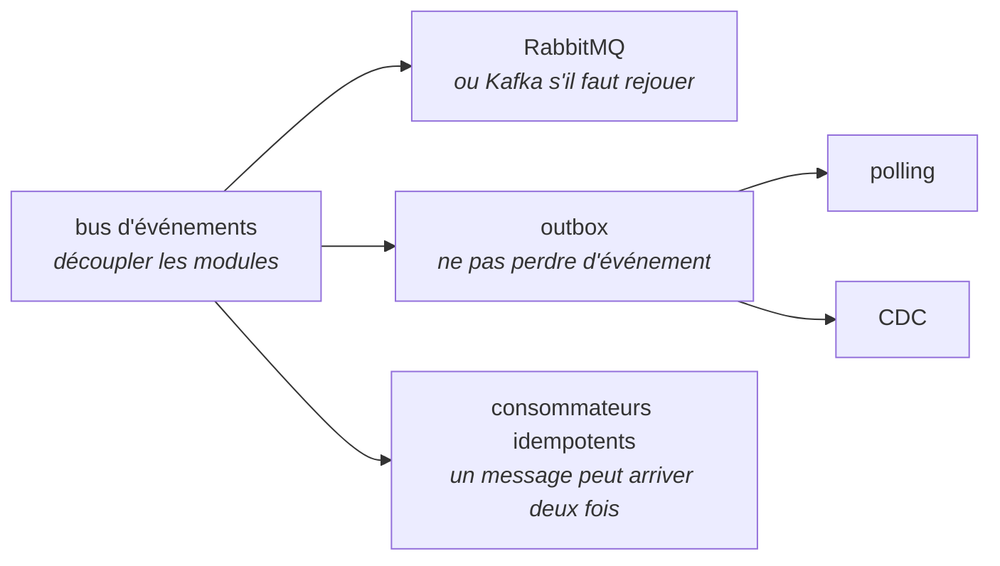
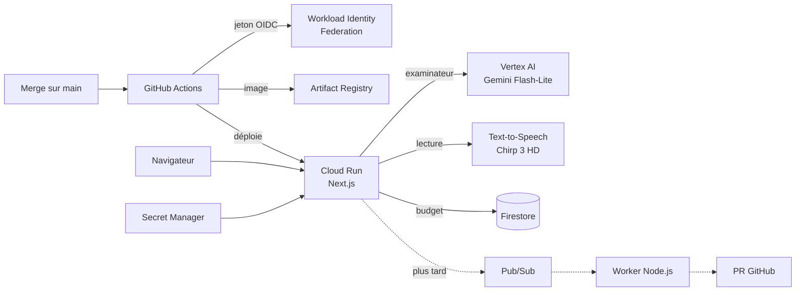

# Mind Kata

[](https://github.com/fgeronimi/mind-kata/actions/workflows/ci.yml)
[](https://web-jvgsc7e3ba-ew.a.run.app)

Outil d'entraînement et d'évaluation par la pratique. On y révise des concepts déclinés
par niveau de séniorité, on répond à des situations dont la réponse attendue est un
**arbre de raisonnement**, et on s'entraîne en conversation avec un examinateur IA qui
relance, puis rend un verdict de niveau.

Le moteur est générique : chaque discipline se branche sous forme de **pack de
domaine**. Le premier est le system design.

**Site** : https://web-jvgsc7e3ba-ew.a.run.app

## Pour qui

- **S'entraîner** : réviser, enchaîner des exercices éclair, répondre à un examinateur
  IA qui relance puis rend un verdict de niveau (confirmé, senior, lead).
- **Évaluer** : faire passer une simulation et obtenir une évaluation argumentée, à
  relire et valider par une personne.

## L'idée centrale : la réponse est un arbre

Face à « plusieurs modules doivent réagir à la création d'un dossier sans dépendre les
uns des autres », la bonne réponse n'est pas un mot-clé. C'est une base, puis des
couches qui la précisent et la justifient :



Un nœud ne compte que si son parent a été cité, ou que son idée a été exprimée :
réciter des mots sans les relier ne rapporte rien. L'IA rattache la
réponse libre aux nœuds et pose les relances ; **le score est calculé par du code
déterministe**, reproductible et explicable ([ADR 0005](docs/adr/0005-score-deterministe-ia-pour-les-relances.md)).

## Architecture



En trait plein, ce qui est en place ; en pointillé, ce qui arrive avec les lots
suivants.

```
apps/web/          Next.js (App Router) : pages, route handlers, server actions,
                   examinateur IA derrière une interface de modèle
packages/content/  packs de domaine en Markdown + YAML, source de vérité
packages/core/     schémas Zod, chargeur de pack, score et rapprochement des réponses
infra/             scripts de préparation du projet GCP, à blanc par défaut
docs/adr/          notes de décision
```

## Stack et pourquoi

| Brique      | Choix                                         | Pourquoi                                                                                                                                                               |
| ----------- | --------------------------------------------- | ---------------------------------------------------------------------------------------------------------------------------------------------------------------------- |
| Application | Next.js 16, App Router, TypeScript strict     | Un seul framework pour le statique, le serveur et le streaming ([ADR 0001](docs/adr/0001-nextjs-seul.md))                                                              |
| Style       | Tailwind CSS 4                                | Standard de l'écosystème, sans couche CSS à maintenir                                                                                                                  |
| Contenu     | Markdown + YAML validés par Zod               | Versionné, relu en PR, validé en CI ([ADR 0003](docs/adr/0003-contenu-dans-git.md), [ADR 0007](docs/adr/0007-contenu-valide-et-rendu-au-build.md))                     |
| Schémas     | Mermaid, dessiné à la demande                 | Schémas en texte, relus en PR ; la bibliothèque n'est chargée que sur les pages qui en contiennent                                                                     |
| Hébergement | Cloud Run, `europe-west1`                     | Conteneur à zéro instance au repos, cible définitive dès le départ ([ADR 0002](docs/adr/0002-premier-jalon-et-infrastructure-progressive.md))                          |
| Déploiement | GitHub Actions + Workload Identity Federation | Aucune clé de compte de service stockée ([ADR 0006](docs/adr/0006-deploiement-sans-cle-par-workload-identity-federation.md))                                           |
| Qualité     | ESLint, Prettier, Vitest, Playwright          | Même `make check` en local et en CI ; parcours joués dans un vrai navigateur, contre le serveur de production                                                          |
| Monorepo    | pnpm workspaces                               | Logique partagée entre application et workers, un seul lockfile                                                                                                        |
| IA          | Gemini Flash-Lite sur Vertex AI               | Sans clé (compte de service), facturé sur GCP, plafonné par l'application ; fournisseur interchangeable ([ADR 0009](docs/adr/0009-mvp-examinateur-conversationnel.md)) |

## Avancement

| Lot                   | Contenu                                                                     | État |
| --------------------- | --------------------------------------------------------------------------- | ---- |
| 0. Socle              | Monorepo, outillage, CI, image Docker, déploiement continu sans clé         | ✅   |
| 1. Contenu et fiches  | Pack system design, schémas Zod, pages concepts, architectures, simulations | ✅   |
| 2. Exercices en arbre | Tirage, réponse, révélation de l'arbre, score par couches                   | ✅   |
| A. Examinateur texte  | Chat, relances ciblées, score par le code, verdict, plafonds, repli         | ✅   |
| B. Voix               | Dictée par le navigateur, lecture par une synthèse serveur plafonnée        | ✅   |
| C. Fiche de séance    | Concepts manquants, liens, version imprimable                               | ⏳   |
| Plus tard             | Simulation complète, comptes, contributions, ingestion, mode évaluation     | —    |

**Premier jalon atteint** (lots 0 à 2) : un site utilisable sans base ni API, avec des
exercices jouables de bout en bout. **MVP conversationnel** (lot A) : l'examinateur IA,
réservé par code d'accès, sans base de données et pour quelques centimes par mois ;
il se joue à l'oral depuis le lot B.

**Contenu du pack system design** : 107 concepts déclinés sur trois niveaux, 62
exercices éclair en arbre, 15 architectures types avec leur schéma, 8 guides (méthode,
ordres de grandeur, arbitrages…), une simulation d'entretien et un tableau
d'équivalences entre frameworks. Les attentes par niveau et les arbres sont en cours de
relecture.

## Lancer en local

Prérequis : Node.js 26 et pnpm 11 (version figée dans `packageManager`).

```bash
make install    # dépendances
make dev        # http://localhost:3000
make check      # formatage, lint, types, tests — ce que vérifie la CI
make build && make test-e2e    # parcours Playwright contre le serveur de production
make test-firestore            # compteur de budget contre l'émulateur Firestore (Docker)
make help       # toutes les cibles
```

Image de production :

```bash
make docker-build && make docker-run    # http://localhost:8080
```

## Décisions

Chaque choix structurant est documenté dans [`docs/adr/`](docs/adr/) : contexte,
options envisagées, décision, conséquences.

1. [Next.js seul, front et back](docs/adr/0001-nextjs-seul.md)
2. [Premier jalon court, infrastructure progressive](docs/adr/0002-premier-jalon-et-infrastructure-progressive.md)
3. [Contenu dans Git, brouillons en base](docs/adr/0003-contenu-dans-git.md)
4. [Moteur générique, domaines en packs](docs/adr/0004-moteur-generique-packs-de-domaine.md)
5. [Score déterministe, IA pour les relances](docs/adr/0005-score-deterministe-ia-pour-les-relances.md)
6. [Déploiement sans clé, par Workload Identity Federation](docs/adr/0006-deploiement-sans-cle-par-workload-identity-federation.md)
7. [Contenu validé et rendu au build](docs/adr/0007-contenu-valide-et-rendu-au-build.md)
8. [Rapprochement lexical des réponses, avant l'IA](docs/adr/0008-rapprochement-lexical-avant-l-ia.md)
9. [MVP : un examinateur conversationnel, sans base de données](docs/adr/0009-mvp-examinateur-conversationnel.md)
10. [Rattachement par IA, parents implicites et relances ciblées](docs/adr/0010-rattachement-par-ia-et-relances-ciblees.md)
11. [Lecture à voix haute par une synthèse serveur, plafonnée au gratuit](docs/adr/0011-lecture-par-synthese-vocale-serveur.md)

## Licences

- Code : [MIT](LICENSE)
- Contenu (`packages/content/`) : [CC BY-SA 4.0](LICENSE-content)
