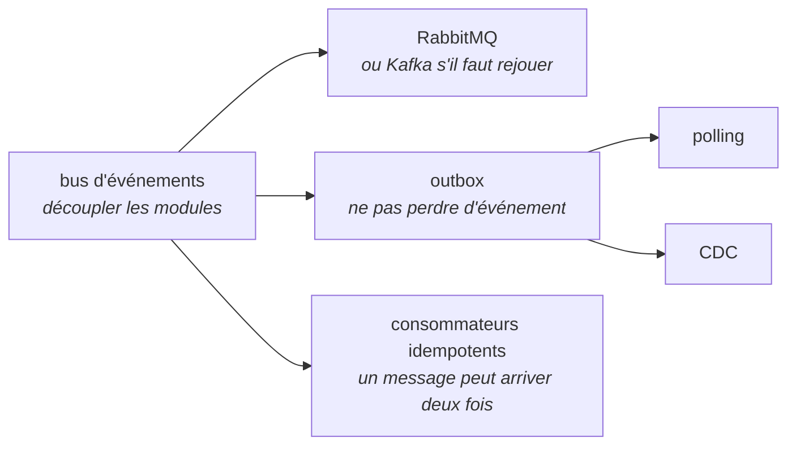
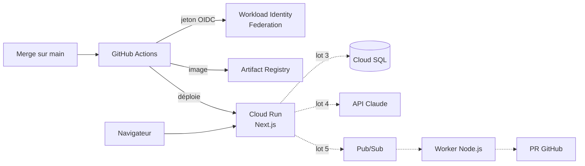

# Mind Kata

[](https://github.com/fgeronimi/mind-kata/actions/workflows/ci.yml)
[](https://web-jvgsc7e3ba-ew.a.run.app)

Outil d'entraînement et d'évaluation par la pratique. On y révise des concepts déclinés
par niveau de séniorité, on répond à des situations dont la réponse attendue est un
**arbre de raisonnement**, et on passe des simulations d'entretien face à un
examinateur IA.

Le moteur est générique : chaque discipline se branche sous forme de **pack de
domaine**. Le premier est le system design.

**Site** : https://web-jvgsc7e3ba-ew.a.run.app

## Pour qui

- **S'entraîner** : réviser, enchaîner des exercices éclair, passer une simulation puis
  recevoir un débrief selon une grille par niveau (confirmé, senior, lead).
- **Évaluer** : faire passer une simulation et obtenir une évaluation argumentée, à
  relire et valider par une personne.

## L'idée centrale : la réponse est un arbre

Face à « plusieurs modules doivent réagir à la création d'un dossier sans dépendre les
uns des autres », la bonne réponse n'est pas un mot-clé. C'est une base, puis des
couches qui la précisent et la justifient :



Un nœud ne compte que si son parent a été cité, et vaut davantage avec sa
justification : réciter des mots sans les relier ne rapporte rien. L'IA rattache la
réponse libre aux nœuds et pose les relances ; **le score est calculé par du code
déterministe**, reproductible et explicable ([ADR 0005](docs/adr/0005-score-deterministe-ia-pour-les-relances.md)).

## Architecture



En trait plein, ce qui est en place ; en pointillé, ce qui arrive avec les lots
suivants.

```
apps/web/          Next.js (App Router) : pages, route handlers, server actions
packages/content/  packs de domaine en Markdown + YAML, source de vérité (lot 1)
packages/core/     logique métier : score des arbres, domaines (lot 1)
infra/             préparation du projet GCP, puis Terraform (lot 3)
docs/adr/          notes de décision
```

## Stack et pourquoi

| Brique      | Choix                                         | Pourquoi                                                                                                                                      |
| ----------- | --------------------------------------------- | --------------------------------------------------------------------------------------------------------------------------------------------- |
| Application | Next.js 16, App Router, TypeScript strict     | Un seul framework pour le statique, le serveur et le streaming ([ADR 0001](docs/adr/0001-nextjs-seul.md))                                     |
| Style       | Tailwind CSS 4                                | Standard de l'écosystème, sans couche CSS à maintenir                                                                                         |
| Contenu     | Markdown + YAML validés par Zod               | Versionné, relu en PR, validé en CI ([ADR 0003](docs/adr/0003-contenu-dans-git.md))                                                           |
| Hébergement | Cloud Run, `europe-west1`                     | Conteneur à zéro instance au repos, cible définitive dès le départ ([ADR 0002](docs/adr/0002-premier-jalon-et-infrastructure-progressive.md)) |
| Déploiement | GitHub Actions + Workload Identity Federation | Aucune clé de compte de service stockée ([ADR 0006](docs/adr/0006-deploiement-sans-cle-par-workload-identity-federation.md))                  |
| Qualité     | ESLint, Prettier, Vitest, Playwright          | Même `make check` en local et en CI                                                                                                           |
| Monorepo    | pnpm workspaces                               | Logique partagée entre application et workers, un seul lockfile                                                                               |

## Avancement

| Lot                        | Contenu                                                                     | État |
| -------------------------- | --------------------------------------------------------------------------- | ---- |
| 0. Socle                   | Monorepo, outillage, CI, image Docker, déploiement continu sans clé         | ✅   |
| 1. Contenu et fiches       | Pack system design, schémas Zod, pages concepts, architectures, simulations | ⏳   |
| 2. Exercices en arbre      | Tirage, réponse, révélation de l'arbre, score par couches                   | —    |
| 3. Back-end et progression | Comptes, progression sauvegardée, répétition espacée, Terraform             | —    |
| 4. Coach IA                | Simulation conversationnelle, relances, débrief selon la grille             | —    |
| 5. Contributions           | Proposition → PR → review IA → validation humaine                           | —    |
| 6. Ingestion de documents  | Document déposé → propositions de contenu à valider                         | —    |
| 7. Mode évaluation         | Après cadrage juridique (AI Act, RGPD)                                      | —    |

Le premier jalon (lots 0 à 2) livre un site utilisable sans base ni API.

## Lancer en local

Prérequis : Node.js 26 et pnpm 11 (version figée dans `packageManager`).

```bash
make install    # dépendances
make dev        # http://localhost:3000
make check      # formatage, lint, types, tests — ce que vérifie la CI
make help       # toutes les cibles
```

Image de production :

```bash
make docker-build && make docker-run    # http://localhost:8080
```

## Décisions

Chaque choix structurant est documenté dans [`docs/adr/`](docs/adr/) : contexte,
options envisagées, décision, conséquences.

1. [Next.js seul, front et back](docs/adr/0001-nextjs-seul.md)
2. [Premier jalon court, infrastructure progressive](docs/adr/0002-premier-jalon-et-infrastructure-progressive.md)
3. [Contenu dans Git, brouillons en base](docs/adr/0003-contenu-dans-git.md)
4. [Moteur générique, domaines en packs](docs/adr/0004-moteur-generique-packs-de-domaine.md)
5. [Score déterministe, IA pour les relances](docs/adr/0005-score-deterministe-ia-pour-les-relances.md)
6. [Déploiement sans clé, par Workload Identity Federation](docs/adr/0006-deploiement-sans-cle-par-workload-identity-federation.md)

## Licences

- Code : [MIT](LICENSE)
- Contenu (`packages/content/`) : [CC BY-SA 4.0](LICENSE-content)
