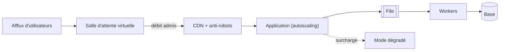

## Quand

On sait qu'un pic arrive, et il dépasse la capacité normale de plusieurs ordres de
grandeur, ou il touche un maillon qui ne scale pas.

## Points d'attention

- On dimensionne pour le pic, pas la moyenne : **test de charge** à deux fois le pic
  attendu, avant l'échéance.
- La **salle d'attente** admet un débit que le système tient, et montre à chacun sa
  position.
- Le maillon qui ne scale pas (base, tiers) fixe le débit admissible.
- **Load shedding** et mode dégradé plutôt qu'une panne générale.
- Préchauffer les caches, prévenir l'hébergeur.
