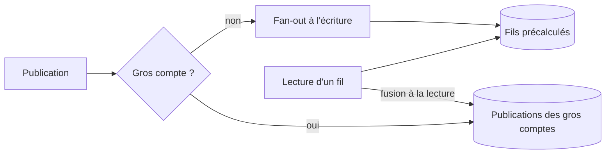

## Quand

Beaucoup plus de lectures que d'écritures, et une distribution très inégale du nombre
d'abonnés.

## Points d'attention

- **Fan-out à l'écriture** : chaque publication est recopiée dans le fil de chaque
  abonné. Lecture instantanée, écriture coûteuse.
- **Fan-out à la lecture** : le fil est assemblé à la demande. Indispensable pour les
  comptes à millions d'abonnés.
- L'**hybride** des deux est la réponse attendue.
- Le classement (chronologique ou pertinence) change tout le reste : le demander.
