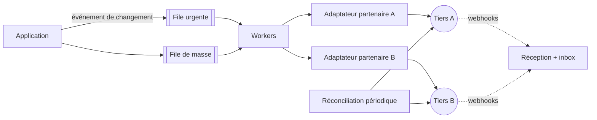

## Quand

On pousse des données vers des partenaires (ou on en reçoit) qui imposent des quotas et
ne sont pas toujours disponibles.

## Points d'attention

- Un **adaptateur par tiers** derrière une interface commune : une panne chez l'un ne
  bloque pas les autres.
- **Timeout court**, retries avec backoff et jitter, **disjoncteur**.
- **Débit sortant maîtrisé** pour respecter les quotas.
- **Coalescence** : d'une rafale de modifications, n'envoyer que la dernière version.
- Une urgence unitaire ne doit pas attendre derrière une opération de masse : files
  séparées, quota réservé.
- **Réconciliation** périodique : les écarts arrivent toujours, il faut les détecter et
  suivre leur taux.
