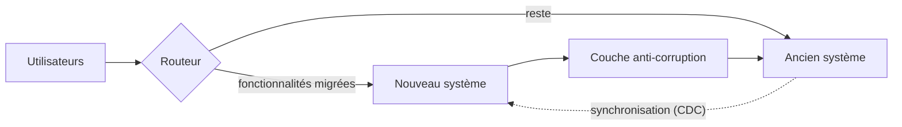

## Quand

L'ancien système porte du chiffre d'affaires ou des obligations, et on ne peut pas
l'arrêter le temps d'une réécriture.

## Points d'attention

- **Tests de caractérisation** sur l'ancien système avant de toucher quoi que ce soit.
- Une **couche anti-corruption** protège le nouveau modèle des défauts de l'ancien.
- Clients pilotes d'abord, mêmes indicateurs mesurés avant et après.
- Les données partagées sont la vraie difficulté : définir la source de vérité à chaque
  étape.
- Une **date de fin** de l'ancien système, sinon on maintient les deux.
