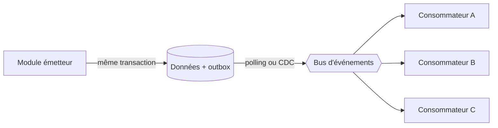

## Quand

Un même fait (une commande validée, un dossier créé) déclenche plusieurs réactions, et on
veut pouvoir en ajouter sans toucher l'émetteur.

## Points d'attention

- **RabbitMQ** pour distribuer des tâches et un bus entre modules ; **Kafka** quand il
  faut rejouer l'historique, absorber un très gros volume ou servir de nombreux
  consommateurs.
- L'outbox garantit qu'aucun événement n'est perdu ; les consommateurs gèrent les
  doublons.
- L'ordre n'est garanti que par clé de partition, jamais globalement.
- Publier l'état complet plutôt qu'un delta simplifie l'idempotence.
