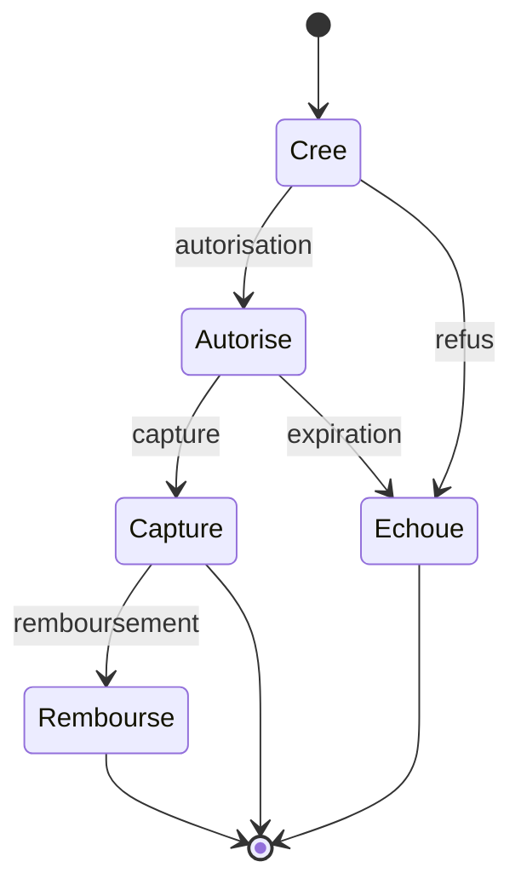

## Quand

Tout flux d'argent : une erreur se paie en litiges, en remboursements et en confiance.

## Points d'attention

- **Clé d'idempotence** sur chaque paiement : un double clic ou un retry ne débite
  jamais deux fois.
- **Registre en partie double**, en ajout seul ; le solde est une projection des
  écritures. Montants en entiers (centimes), jamais en flottants.
- **Machine à états** explicite : créé, autorisé, capturé, remboursé, échoué.
- C'est le **webhook du prestataire** qui fait foi, pas le retour du navigateur ; les
  webhooks passent par une inbox pour ignorer les doublons.
- Prestataires derrière un adaptateur ; timeout, retries, disjoncteur.
- Commande, paiement et stock en **saga**, avec remboursement en compensation.
- **Rapprochement** quotidien avec le relevé du prestataire. Tokenisation des cartes.
