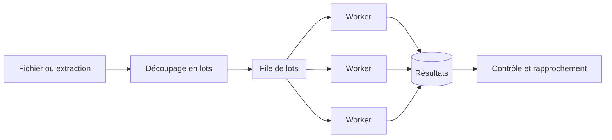

## Quand

Un volume trop gros pour une requête (import nocturne, calcul mensuel, génération de
milliers de documents), avec des règles qui changent dans le temps.

## Points d'attention

- **Import différentiel** d'abord : ne traiter que ce qui a changé.
- Lots **idempotents** et reprenables : un lot en échec se rejoue sans doublon.
- Une file et des workers **séparés** des traitements interactifs.
- **Règles versionnées par date** : on recalcule le passé avec les règles du passé.
- **Double run** lors d'un changement de moteur : comparer avant de basculer.
- Mémoire : traiter en flux, par paquets, sans tout charger.
