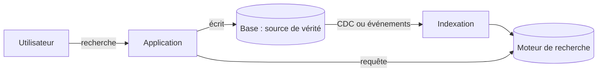

## Quand

La recherche dépasse le `LIKE` : pertinence, tolérance aux fautes, autocomplétion,
filtres combinés, distance.

## Points d'attention

- Le moteur de recherche n'est **jamais la source de vérité** : il se reconstruit depuis
  la base.
- Alimentation par événements ou CDC ; un léger retard est normal, à annoncer.
- Recherche floue (distance de Levenshtein, n-grammes) ; pour un besoin simple, les
  extensions de la base relationnelle suffisent.
- Prévoir la réindexation complète sans coupure.
