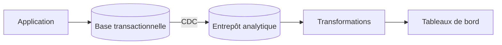

## Quand

Des requêtes analytiques lourdes (agrégats sur des mois, croisements) qui ralentiraient
la base de production.

## Points d'attention

- **Jamais de reporting sur la base de production** : un entrepôt séparé, alimenté en
  continu.
- Transactionnel et analytique ont des besoins opposés : ce sont deux bases.
- Les données arrivent avec un délai : le dire aux utilisateurs des tableaux de bord.
- Les données personnelles suivent jusque dans l'entrepôt : même minimisation, même purge.
