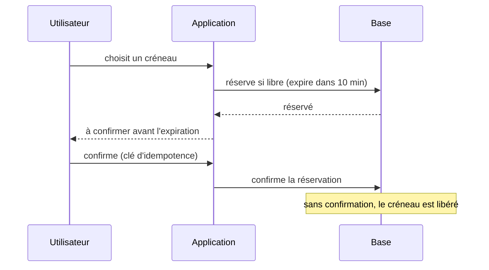

## Quand

Deux personnes ne doivent jamais obtenir la même place, et la demande dépasse l'offre.

## Points d'attention

- **Réservation temporaire** : la ressource est bloquée quelques minutes, puis libérée
  automatiquement (expiration en base ou dans le cache).
- **Verrouillage optimiste** (numéro de version) quand les conflits sont rares ;
  **pessimiste** (`SELECT … FOR UPDATE`) quand ils sont fréquents ou coûteux.
- Une contrainte d'unicité en base reste le dernier rempart.
- Les robots raflent les places : limitation de débit et anti-robots.
