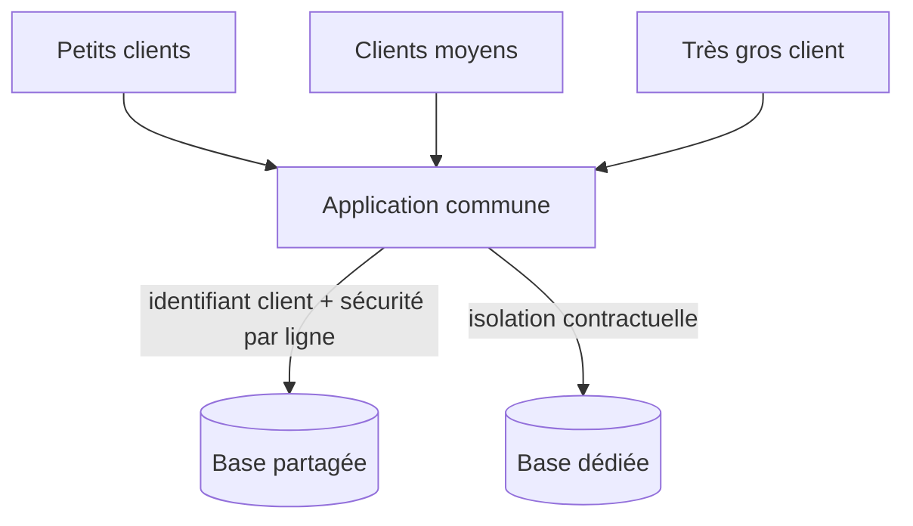

## Quand

Un produit vendu à de nombreux clients, où l'isolation, les quotas et le coût par client
comptent autant que les fonctionnalités.

## Points d'attention

- **Base partagée avec identifiant client** par défaut : la plus simple à opérer.
- **Sécurité au niveau des lignes** pour qu'une requête oubliée ne fuie jamais.
- Le **voisin bruyant** : quotas par client, files séparées pour les gros comptes.
- Une base dédiée seulement sur exigence contractuelle ou volume hors norme.
- **Configuration plutôt que développement spécifique** : chaque exception se paie à
  chaque version.
