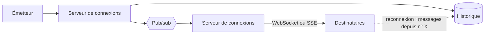

## Quand

L'utilisateur doit voir un changement sans recharger, en quelques centaines de
millisecondes.

## Points d'attention

- **SSE** quand seul le serveur pousse (notifications, tableau de bord) ; **WebSocket**
  quand le client envoie aussi.
- Les connexions sont réparties sur plusieurs serveurs : un **pub/sub** les relie.
- L'ordre est garanti **par conversation**, pas globalement : partition par
  conversation, numéro de séquence attribué par le serveur.
- À la reconnexion, le client demande ce qu'il a manqué depuis son dernier numéro.
- Le nombre de connexions ouvertes se dimensionne à part.
