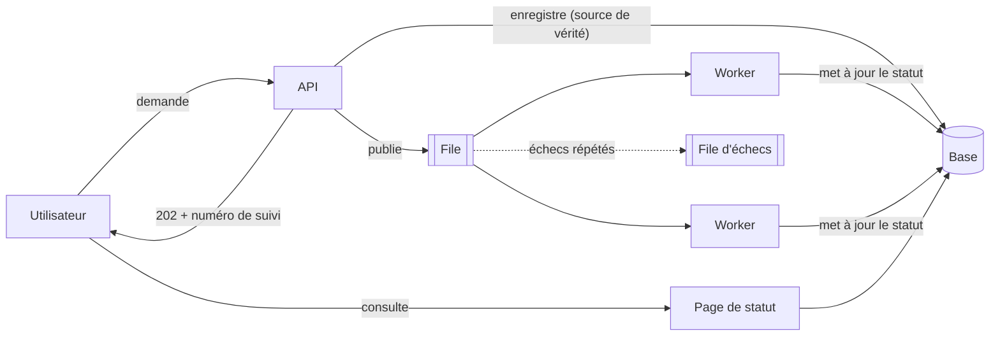

## Quand

Le traitement prend plus de quelques secondes, dépend d'un tiers, ou arrive par vagues.
L'utilisateur n'a pas à attendre, et la charge est lissée.

## Points d'attention

- La **base est la source de vérité**, la file n'est qu'un transport : une tâche de
  rattrapage republie ce qui est resté en attente.
- Les workers reçoivent un message au moins une fois : traitement **idempotent**.
- Retries avec backoff, puis file d'échecs pour les vraies erreurs.
- Loi de Little pour dimensionner : traitements simultanés = débit × durée.
- L'utilisateur voit un statut horodaté, pas un écran figé.
