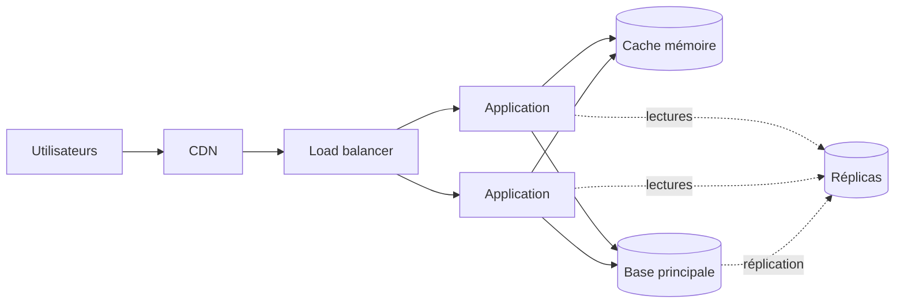

## Quand

Beaucoup de lectures, des données qui changent peu, des pics à absorber. C'est
l'architecture de départ de la plupart des sites et des API publiques.

## Points d'attention

- Des instances **sans état** : sessions dans le cache ou dans un jeton, fichiers sur un
  stockage objet. Sinon, impossible d'en ajouter.
- L'ordre d'escalade : index et requêtes, puis cache, puis asynchrone, puis réplicas,
  puis partitionnement.
- Les réplicas ont quelques millisecondes de retard : un utilisateur doit lire ses
  propres écritures sur la base principale.
